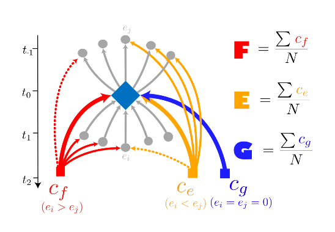
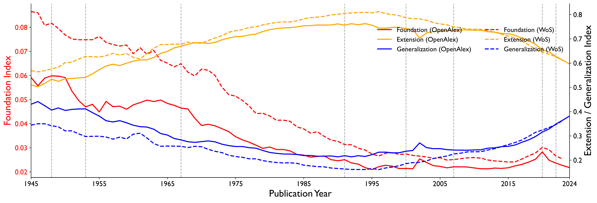
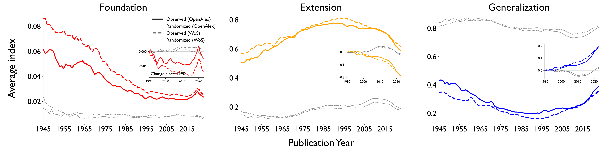
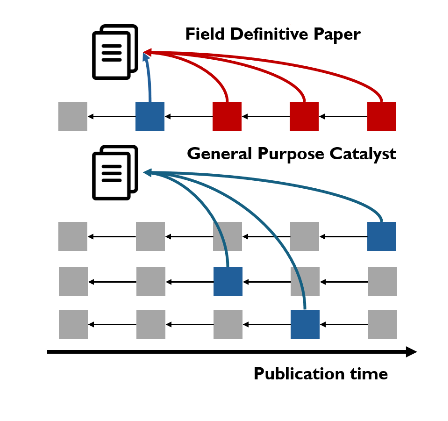
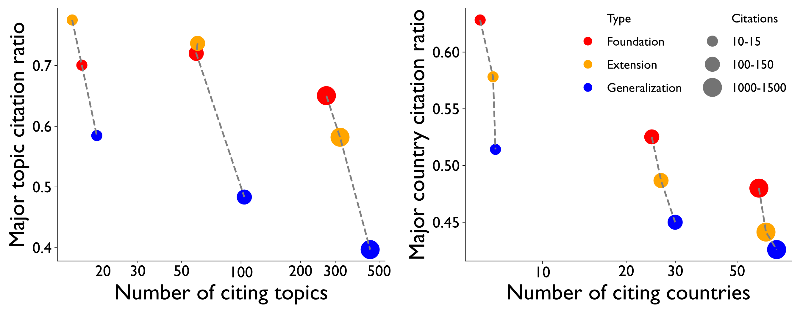
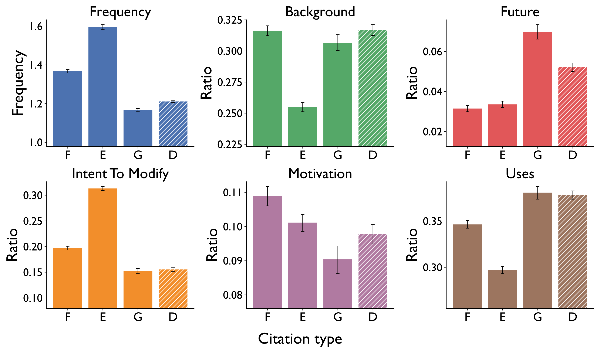
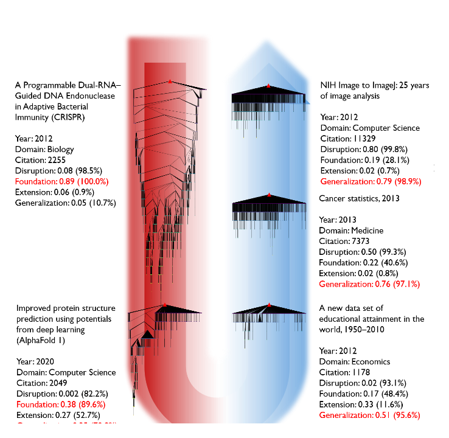
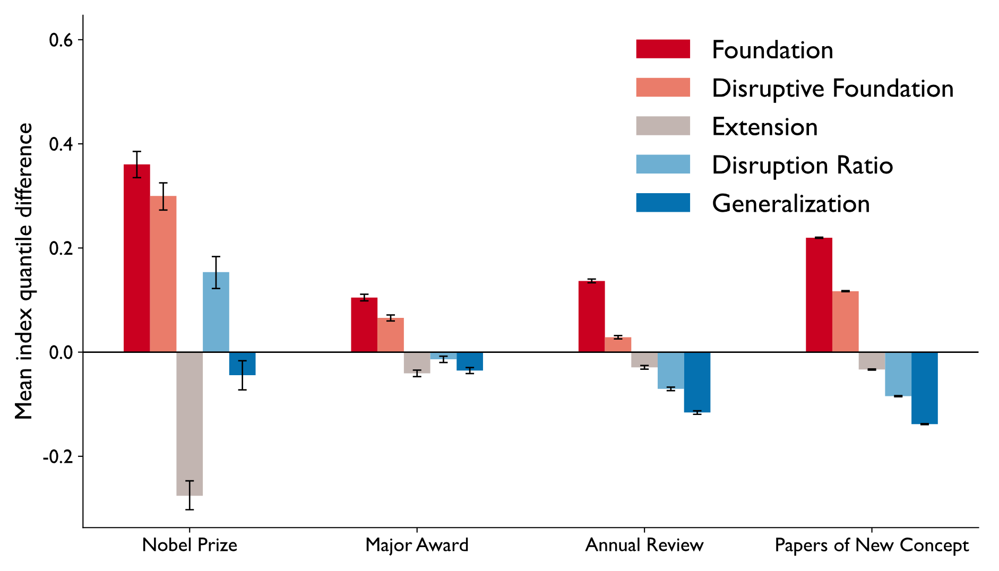
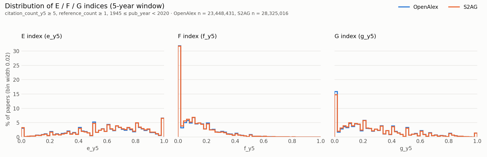

# Generalization and the Rise of System-level Creativity in Science

[](https://arxiv.org/abs/2510.03240)
[](https://doi.org/10.5281/zenodo.23817258)

Replication package for **Hongbo Fang and James Evans, "Generalization and the Rise of
System-level Creativity in Science"**, [arXiv:2510.03240](https://arxiv.org/abs/2510.03240).

Most measures of innovation look at what a paper *draws on*. This paper instead measures how a
paper's knowledge is *taken up* by later work. Using citation networks covering tens of millions
of papers, each paper's contribution is split into three roles: **Foundation**, **Extension**,
and **Generalization**. Foundational and extensional work dominated the post-war decades and
declined after the 1990s. Generalization, where an idea is reused in contexts far from where it
came from, rose sharply over the same period. The paper argues that this challenges the
"declining innovation" story told by the disruption index, and that innovation has moved from
within disciplines to between them.

| | |
|---|---|
| 📄 Paper | <https://arxiv.org/abs/2510.03240> |
| 💻 Code + figure data (this repository) | <https://github.com/fhbzc/Generalization-replication> |
| 🗄️ Paper-level F / E / G indices (OpenAlex, Semantic Scholar)<br><sub>only papers with ≥ 5 citations in 5 years and ≥ 1 reference, published 1945–2019</sub> | Zenodo: [10.5281/zenodo.23817258](https://doi.org/10.5281/zenodo.23817258) |

## The idea: three ways a paper gets used

<p align="center"></p>

Each paper that cites a focal paper (blue diamond) is classified by where it sits in the focal
paper's local citation network. We count how many of the focal paper's **other citing papers**
it also cites (e<sub>i</sub>, downstream) and how many of the focal paper's own **references** it
also cites (e<sub>j</sub>, upstream).

- **Foundation (F)**, e<sub>i</sub> > e<sub>j</sub>: the citing paper mostly cites other papers
  that build on the focal paper, treating it as a foundational work.
- **Extension (E)**, e<sub>i</sub> < e<sub>j</sub>: the citing paper mostly cites the work the
  focal paper itself built on, treating it as an extension of earlier foundations.
- **Generalization (G)**, e<sub>i</sub> = e<sub>j</sub> = 0: the citing paper cites none of the
  focal paper's references or citers, treating it as a general tool or background.

A paper's F, E and G indices are the shares of its citations of each type, so F + E + G = 1
(ties are split 0.5 / 0.5 between F and E).

## Main result: the rise of generalization

<p align="center"></p>

**Fig. 3a.** Yearly mean F (left axis), E and G (right axis) by publication year in OpenAlex
(solid) and Web of Science (dashed), using citations in the first year after publication.
Foundation falls steadily. Extension peaks in the mid-1990s and then declines, while
Generalization turns sharply upward after the 1990s. The two corpora agree closely.

<p align="center"></p>

**Fig. 3b.** The same indices in the observed citation network (colour) and in randomized
networks (grey), in which citation links are reshuffled while approximately preserving each
paper's degree within publication year and venue. Insets show the change since 1990.
Generalization rises by about 0.2 in the observed network and far less in the randomized
one, so the trend is not produced by growth or degree structure alone.

## What does generalization capture?

<table>
<tr>
<td width="34%"></td>
<td></td>
</tr>
<tr>
<td valign="top"><b>Fig. 1e.</b> A <i>field-defining</i> paper is cited by works in one densely
connected research topic, so its citations are mostly foundational. A <i>general-purpose
catalyst</i> is cited by works that are not connected to each other, so its citations are
generalizations spread across independent research trajectories.</td>
<td valign="top"><b>Fig. 2c.</b> The top 10% F, E and G papers, grouped by citation count
(marker size). G papers are cited from many more topics (left) and countries (right), and
less of their citation comes from a single dominant topic or country.</td>
</tr>
</table>

<p align="center"></p>

**Fig. 2f.** Citation purposes in NLP papers, from a classifier applied to the citation
context, for foundational (F), extensional (E), generalizational (G) and disruptive (D)
citations. Generalization citations are mentioned least often per citing paper and are most
often about *using* the work or pointing to *future* work. Extension citations are dominated by
*intent to modify*. Disruptive citations look much like generalization citations.

## Generalization, foundation and disruption

The disruption index treats a paper as disruptive when later work cites it without citing its
predecessors. The F / E / G indices separate two very different kinds of "disruptive" papers.

<p align="center"></p>

**Fig. 2a.** Five highly disruptive papers (all above the 82nd percentile of disruption),
arranged from most foundational to most generalizational, with their downstream citation trees.
CRISPR (left, top) has a deep, narrow tree: research keeps building on it generation after
generation (Foundation 0.89, 100th percentile). ImageJ (right, top) has a shallow, broad tree:
it is used by many unconnected works (Generalization 0.79, 98.9th percentile). Values in
parentheses are percentiles within the same year and domain.

<p align="center"></p>

**Extended Data Fig. 5a.** How well each index separates landmark papers from comparison papers:
Nobel Prize papers vs other papers, major-award papers vs other papers, references cited by
annual reviews vs the reviews themselves, and papers introducing new concepts vs other papers.
Bars show the mean quantile difference (higher = favours the landmark papers). Foundation
separates the groups best in all four comparisons. The disruption index does so only for Nobel
Prize papers, and Generalization, which measures broad reuse rather than field-defining
discovery, does not.

## Paper-level data

<p align="center"></p>

The [Zenodo release](https://doi.org/10.5281/zenodo.23817258) gives, for every included paper,
its id, title, publication year, reference count, 5-year citation count and the three indices
(5-year citation window).

> ⚠️ **Only a filtered subset of papers is released.** A paper is included only if it has
> **at least 5 citations within 5 years of publication** (`citation_count_y5 >= 5`) **and at
> least 1 reference** (`reference_count >= 1`), and was published 1945–2019. This leaves
> 23,448,431 of 191,457,232 OpenAlex papers and 28,325,016 of 218,455,234 Semantic Scholar
> papers. Papers outside these criteria are not in the files.

The plot shows the distribution of the three indices among the included papers. The two corpora
are almost identical.

All figures in the paper are in [`figure_graph/`](figure_graph) as SVG, each with the CSV of
the numbers it plots. The PNGs above, with white backgrounds so they also read in dark mode, are
in [`docs/figures/`](docs/figures). Panels from Fig. 1 and Fig. 2a are taken from the arXiv
version of the paper.

## Citation

```bibtex
@article{fang2025generalization,
  title   = {Generalization and the Rise of System-level Creativity in Science},
  author  = {Fang, Hongbo and Evans, James},
  journal = {arXiv preprint arXiv:2510.03240},
  year    = {2025}
}
```

## Repository layout

The same analysis is run independently on four corpora: OpenAlex (the main one), Web of Science,
Semantic Scholar and MAG. Each has its own directory with its own `utils.py` and `data/` root.

### What is released

- **`figure_graph/`** — every paper figure, under its panel name (`Fig. 3a.svg`,
  `Extended Data Fig. 8.svg`, ...), together with the **aggregated cache** it was drawn from:
  the same-named `.csv` holding the numbers actually plotted (means, ratios, bootstrap CIs, n's).
  Plotting scripts reload that cache to redraw a figure without recomputing anything.
- **Paper-level data (Zenodo)** — the per-paper F / E / G indices (5-year citation window)
  with id, title, publication year, reference count and citation count, for OpenAlex
  (23.4M papers) and Semantic Scholar (28.3M papers). **Only papers with ≥ 5 citations within
  5 years and ≥ 1 reference, published 1945–2019, are included.** Too large for GitHub (~8 GB), so it is deposited on
  Zenodo with its own README describing every column.
- The remaining intermediate tables (citation networks, reshuffled networks, distance
  tables) are regenerated by the pipelines below from the raw corpora. Web of Science and
  MAG are licensed / retired datasets, so only aggregated results from them are released.

### Code

- **`openalex/`** — the main pipeline: metadata parsing, the F/E/G and disruption indices, and
  every downstream analysis (text, references, heatmaps, regressions, citation purpose, awards,
  keywords, AI usage, diffusion), one subdirectory each.
- **`wos/`** — Web of Science replication: metadata, F/E/G, disruption, quantiles, the
  review-vs-reference venue validation and the venue-controlled reshuffle null model.
- **`semantic_scholar/`** — Semantic Scholar replication plus the full-text analyses (S2ORC
  section parsing, in-text citation positions) and the ForeCite keyword validation.
- **`MAG/`** — Microsoft Academic Graph replication (F/E/G, disruption, author academic age).
- **`combine_wos_openalex/`** — figures that put two or more corpora on one axis: the
  longitudinal trend, the observed-vs-reshuffle comparison, the validation-gap summary.
- **`R_analysis/`** — `main.Rmd`, the regression tables on the OpenAlex F/E/G table.

## Data sources

The raw corpora are not redistributed; obtain them from their providers and point each
corpus's `utils.py` at your copy.

- **OpenAlex** — snapshot from <https://docs.openalex.org/download-all-data/openalex-snapshot> (CC0).
  - Main pipeline (`OPENALEX_DIRE`): **release 2025-01-29**, downloaded 2025-02-21.
  - `openalex/2026_version/` and `combine_wos_openalex/` (`OPENALEX_DIRE_2026`): **release 2026-02-03**,
    downloaded 2026-02-03.
- **Semantic Scholar Academic Graph** — via the Datasets API (`semantic_scholar/download_s2ag.py`;
  needs your own API key in `semantic_scholar/utils.py`) (ODC-BY 1.0).
  - `papers`, `citations`, `abstracts`, `authors`, `tldrs`, `embeddings-specter_v2`: **release 2025-12-09**,
    downloaded 2025-12-23 – 2026-01-04.
  - `s2orc` (full-text analyses only): files built 2026-01-30, downloaded 2026-05-31 — a later
    release than the other datasets.
  - `download_s2ag.py` always fetches the *latest* release; to reproduce exactly, set `RELEASE_ID`
    to the release above instead.
- **Web of Science** — institutional license from Clarivate.
- **MAG** — Microsoft Academic Graph, December 2021 snapshot (ODC-BY 1.0).

## Where to start

Each corpus directory has a plain-text document listing every script in run order with its
description, inputs and outputs — read these first:
`openalex/Workpipeline_openalex.txt`, `wos/Workpipeline_wos.txt`,
`semantic_scholar/Workpipelin_semantic_scholar.txt`, `MAG/Workpipeline_MAG.txt`,
`combine_wos_openalex/Workpipeline_longitudional.txt`.

## Conventions

- **Paths** live in each corpus's `utils.py` (`META_DIRE`, the raw snapshot, and one constant per
  external dataset the pipeline consumes but does not produce). Point them at your storage first.
- **Parameters** sit in a settings block at the top of each script and are baked into its
  filenames, so different settings never overwrite each other; a script's parameters must match
  the upstream run that produced its input.
- **Figure names** are guarded by a flag (`is_fig3a`, `is_ed_fig`, ...) testing every parameter
  that changes the panel. Only at the paper's settings does a script write `Fig. 3a.svg`;
  otherwise it writes a descriptive parameterised name.
