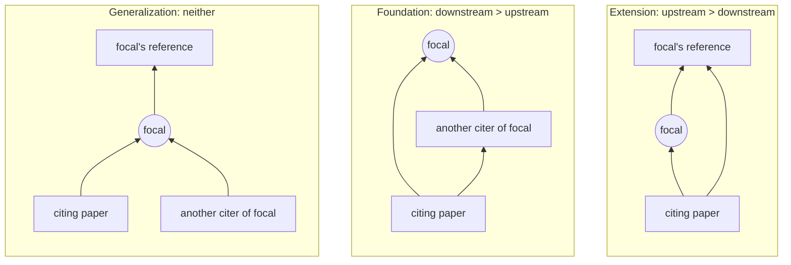

# Generalization and the Rise of System-level Creativity in Science

[](https://arxiv.org/abs/2510.03240)
[](https://doi.org/10.5281/zenodo.23817258)

Replication package for **Hongbo Fang and James Evans, "Generalization and the Rise of
System-level Creativity in Science"**, [arXiv:2510.03240](https://arxiv.org/abs/2510.03240).

Most measures of innovation look at what a paper *draws on*. This paper instead measures how a
paper's knowledge is *taken up* by later work. Using citation networks covering tens of millions
of papers, each paper's contribution is split into three roles: **Foundation**, **Extension**,
and **Generalization**. Foundational and extensional work dominated the post-war decades and
declined after the 1990s. Generalization, where an idea is reused in contexts far from where it
came from, rose sharply over the same period. The paper argues that this challenges the
"declining innovation" story told by the disruption index, and that innovation has moved from
within disciplines to between them.

| | |
|---|---|
| 📄 Paper | <https://arxiv.org/abs/2510.03240> |
| 💻 Code + figure data (this repository) | <https://github.com/fhbzc/Generalization-replication> |
| 🗄️ Paper-level F / E / G indices (OpenAlex, Semantic Scholar) | Zenodo: [10.5281/zenodo.23817258](https://doi.org/10.5281/zenodo.23817258) |

## The idea: three ways a paper gets used

Each paper that cites a focal paper (within 5 years) is classified by where it sits in the
focal paper's local citation network. We count how many of the focal paper's own **references**
it also cites (upstream) and how many of the focal paper's **other citing papers** it also cites
(downstream).


<sub>Arrows mean "cites".</sub>

- **Extension (E)**: the citing paper continues the line of work the focal paper itself built on.
- **Foundation (F)**: the citing paper joins a community building on the focal paper, which
  becomes a shared foundation.
- **Generalization (G)**: the citing paper is connected to none of the focal paper's
  neighbourhood. The idea has been carried into a new context.

Ties are split 0.5 / 0.5 between E and F. Each index is the share of the focal paper's citations
of that kind, so F + E + G = 1.

## Key results

**The rise of generalization.** Yearly mean of the three indices by publication year, in
OpenAlex (solid) and Web of Science (dashed). Foundation falls steadily. Extension peaks in the
mid-1990s and then declines, and Generalization rises sharply after the 1990s. The two corpora
agree closely.


<sub>`figure_graph/Fig. 3a.svg`, drawn by `combine_wos_openalex/plot_longitudional_change.py`.</sub>

**Not an artefact of the citation network.** Observed indices (colour) against the same indices
on a randomized citation network (grey) that keeps each paper's citation counts and venue
fixed. Insets show the change since 1990. Generalization rises by about 0.2 in the observed
network, while the randomized network moves far less.


<sub>`figure_graph/Fig. 3b.svg`, drawn by `combine_wos_openalex/visualize_efg_obs_vs_single_iter_control_venue_combined.py`.</sub>

**Validation against distance.** Median index across bins of reference distance (venue
embeddings) and semantic distance (title embeddings). The three indices occupy different
regions of the distance space.


<sub>`figure_graph/Fig. 2b.svg`, drawn by `openalex/heatmap/visualize_within_dist_heatmap.py`.</sub>

**Paper-level data.** The distribution of the three indices in the Zenodo release is almost
identical between OpenAlex and Semantic Scholar.


<sub>`figure_graph/efg_distribution.png`, drawn by `openalex/feg_distribution/plot_efg_distribution_public_release.py`.</sub>

Every figure in the paper is in [`figure_graph/`](figure_graph), together with the CSV of the
numbers it plots.

## Citation

```bibtex
@article{fang2025generalization,
  title   = {Generalization and the Rise of System-level Creativity in Science},
  author  = {Fang, Hongbo and Evans, James},
  journal = {arXiv preprint arXiv:2510.03240},
  year    = {2025}
}
```

## Repository layout

The same analysis is run independently on four corpora: OpenAlex (the main one), Web of Science,
Semantic Scholar and MAG. Each has its own directory with its own `utils.py` and `data/` root.

## Results

- **`figure_graph/`** — every paper figure, under its panel name (`Fig. 3a.svg`,
  `Extended Data Fig. 8.svg`, ...), together with the **aggregated cache** it was drawn from:
  the same-named `.csv` holding the numbers actually plotted (means, ratios, bootstrap CIs, n's).
  Plotting scripts reload that cache to redraw a figure without recomputing anything.
- **Paper-level data (Zenodo)** — the per-paper F / E / G indices (5-year citation window)
  with id, title, publication year, reference count and citation count, for OpenAlex
  (23.4M papers) and Semantic Scholar (28.3M papers): papers with ≥ 5 citations in 5 years,
  ≥ 1 reference, published 1945–2019. Too large for GitHub (~8 GB), so it is deposited on
  Zenodo with its own README describing every column.
- The remaining intermediate tables (citation networks, reshuffled networks, distance
  tables) are regenerated by the pipelines below from the raw corpora. Web of Science and
  MAG are licensed / retired datasets, so only aggregated results from them are released.

## Code

- **`openalex/`** — the main pipeline: metadata parsing, the F/E/G and disruption indices, and
  every downstream analysis (text, references, heatmaps, regressions, citation purpose, awards,
  keywords, AI usage, diffusion), one subdirectory each.
- **`wos/`** — Web of Science replication: metadata, F/E/G, disruption, quantiles, the
  review-vs-reference venue validation and the venue-controlled reshuffle null model.
- **`semantic_scholar/`** — Semantic Scholar replication plus the full-text analyses (S2ORC
  section parsing, in-text citation positions) and the ForeCite keyword validation.
- **`MAG/`** — Microsoft Academic Graph replication (F/E/G, disruption, author academic age).
- **`combine_wos_openalex/`** — figures that put two or more corpora on one axis: the
  longitudinal trend, the observed-vs-reshuffle comparison, the validation-gap summary.
- **`R_analysis/`** — `main.Rmd`, the regression tables on the OpenAlex F/E/G table.

## Data sources

The raw corpora are not redistributed; obtain them from their providers and point each
corpus's `utils.py` at your copy.

- **OpenAlex** — snapshot from <https://docs.openalex.org/download-all-data/openalex-snapshot> (CC0).
  - Main pipeline (`OPENALEX_DIRE`): **release 2025-01-29**, downloaded 2025-02-21.
  - `openalex/2026_version/` and `combine_wos_openalex/` (`OPENALEX_DIRE_2026`): **release 2026-02-03**,
    downloaded 2026-02-03.
- **Semantic Scholar Academic Graph** — via the Datasets API (`semantic_scholar/download_s2ag.py`;
  needs your own API key in `semantic_scholar/utils.py`) (ODC-BY 1.0).
  - `papers`, `citations`, `abstracts`, `authors`, `tldrs`, `embeddings-specter_v2`: **release 2025-12-09**,
    downloaded 2025-12-23 – 2026-01-04.
  - `s2orc` (full-text analyses only): files built 2026-01-30, downloaded 2026-05-31 — a later
    release than the other datasets.
  - `download_s2ag.py` always fetches the *latest* release; to reproduce exactly, set `RELEASE_ID`
    to the release above instead.
- **Web of Science** — institutional license from Clarivate.
- **MAG** — Microsoft Academic Graph, December 2021 snapshot (ODC-BY 1.0).

## Where to start

Each corpus directory has a plain-text document listing every script in run order with its
description, inputs and outputs — read these first:
`openalex/Workpipeline_openalex.txt`, `wos/Workpipeline_wos.txt`,
`semantic_scholar/Workpipelin_semantic_scholar.txt`, `MAG/Workpipeline_MAG.txt`,
`combine_wos_openalex/Workpipeline_longitudional.txt`.

## Conventions

- **Paths** live in each corpus's `utils.py` (`META_DIRE`, the raw snapshot, and one constant per
  external dataset the pipeline consumes but does not produce). Point them at your storage first.
- **Parameters** sit in a settings block at the top of each script and are baked into its
  filenames, so different settings never overwrite each other; a script's parameters must match
  the upstream run that produced its input.
- **Figure names** are guarded by a flag (`is_fig3a`, `is_ed_fig`, ...) testing every parameter
  that changes the panel. Only at the paper's settings does a script write `Fig. 3a.svg`;
  otherwise it writes a descriptive parameterised name.
